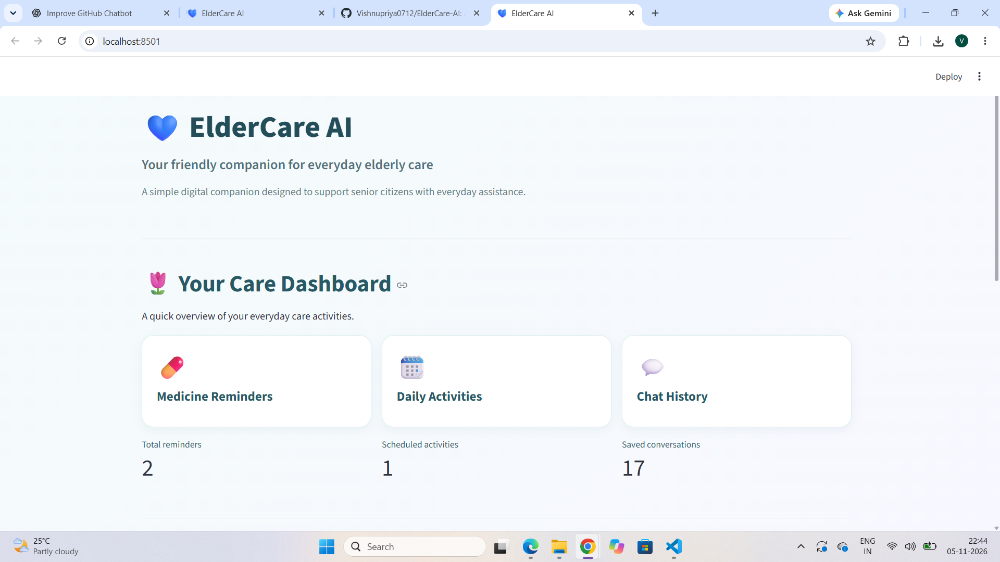
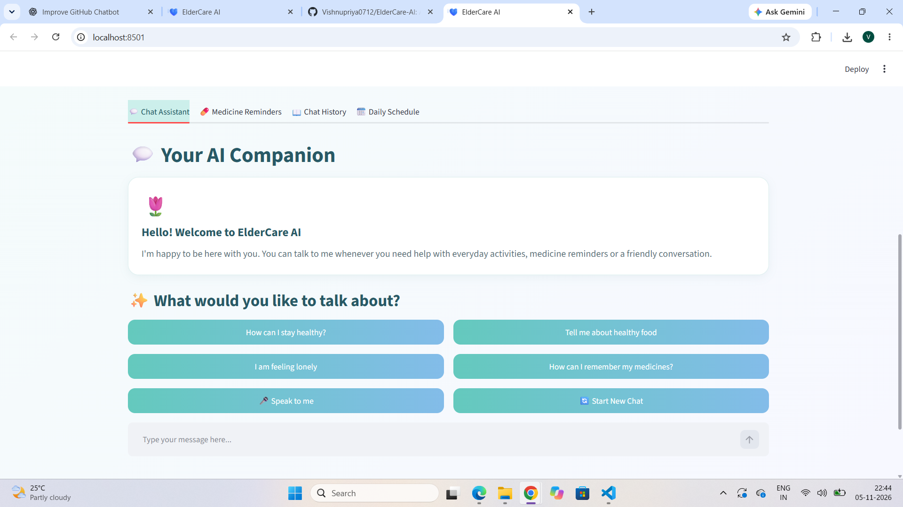
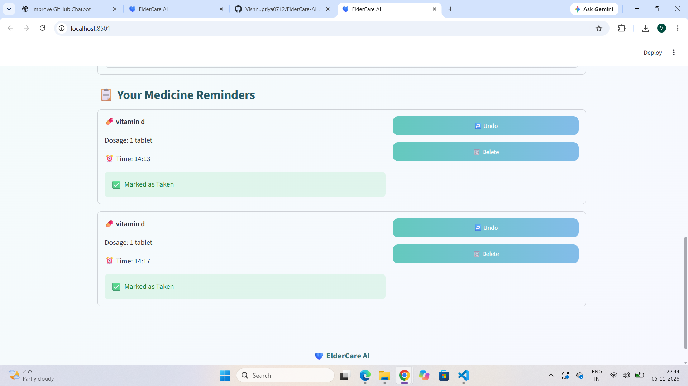
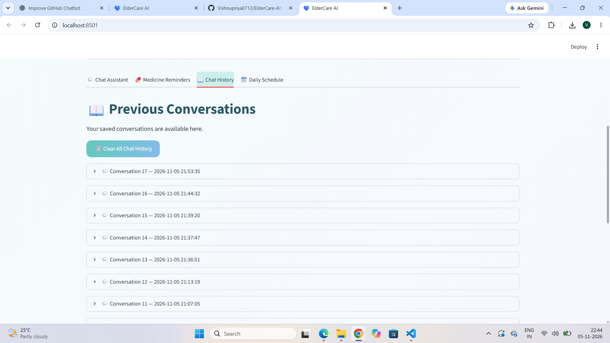
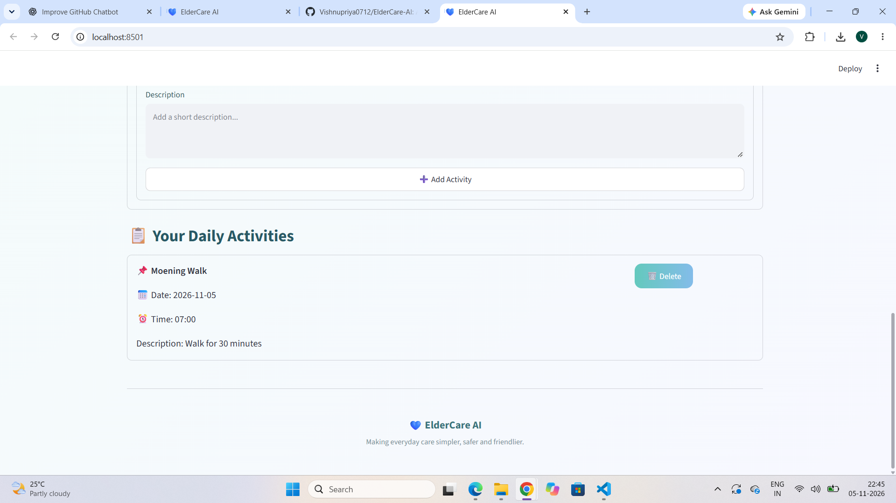

# 💙 ElderCare AI – Intelligent Elderly Care Assistant

An AI-powered elderly care assistant designed to support senior citizens through conversational assistance, medicine reminders, voice interaction, and daily activity management.

## 🌟 Project Overview

ElderCare AI combines Machine Learning and an interactive Streamlit interface to provide a simple and accessible digital companion for elderly people.

The application uses an ML-based intent classification chatbot to understand user messages and provide relevant responses.

## ✨ Key Features

### 🤖 AI Chat Assistant
- ML-powered chatbot using TF-IDF and Logistic Regression.
- Supports 12 predefined conversation intents.
- Context-aware conversational follow-ups.
- Emergency keyword detection for selected emergency phrases.

### 💊 Medicine Reminders
- Add and manage medicine reminders.
- Store medicine name, dosage, and reminder time.
- Delete existing reminders.
- Save reminder information using JSON files.

### 🎙️ Voice Assistant
- Speech-to-text input using SpeechRecognition.
- Text-to-speech responses using pyttsx3.
- Supports voice-based interaction.

### 📅 Daily Schedule
- Add and manage daily activities.
- View scheduled activities.
- Store schedule information locally.

### 💬 Chat History
- Save previous conversations.
- View saved chat history.
- Clear conversation history.

### 🔔 Alerts
- Check medicine reminders and scheduled activities when the application runs or refreshes.

## 🧠 Machine Learning Approach

The chatbot uses a text classification pipeline consisting of:

- **TF-IDF Vectorizer:** Converts text into numerical features.
- **N-grams:** Uses unigram and bigram features.
- **Logistic Regression:** Predicts the user's intent.
- **Intent Dataset:** 12 categories with 465 training patterns.

### Model Evaluation

The model was evaluated using a manually created set of 36 unseen messages.

| Metric | Result |
|---|---:|
| Test messages | 36 |
| Correct predictions | 35 |
| Incorrect predictions | 1 |
| Accuracy | 97.22% |

**Note:** This is a preliminary evaluation on a small manually created test set. It does not establish real-world chatbot accuracy.

## 🛠️ Technologies Used

- Python
- Streamlit
- Scikit-learn
- Pandas
- TF-IDF
- Logistic Regression
- SpeechRecognition
- pyttsx3
- PyAudio
- JSON

## 📸 Application Screenshots

### Dashboard


### Chat Assistant


### Medicine Reminders


### Chat History


### Daily Schedule


## 📂 Project Structure

```text
ElderCare-AI/
│
├── app.py
├── chatbot.py
├── reminders.py
├── voice_assistant.py
├── chat_history.py
├── daily_schedule.py
├── alerts.py
│
├── intents.json
├── eldercare_intent_pipeline.pkl
├── train_model.py
├── test_model.py
├── evaluate_model.py
├── evaluate_unseen.py
│
├── requirements.txt
├── .gitignore
│
└── screenshots/
```

## ⚙️ Installation and Setup

### 1. Clone the repository

```bash
git clone https://github.com/Vishnupriya0712/ElderCare-AI.git
```

### 2. Navigate to the project directory

```bash
cd ElderCare-AI
```

### 3. Create a virtual environment

```bash
python -m venv venv
```

### 4. Activate the virtual environment

**Windows:**

```bash
venv\Scripts\activate
```

### 5. Install dependencies

```bash
pip install -r requirements.txt
```

### 6. Run the application

```bash
streamlit run app.py
```

The application will open in your browser.

## ⚠️ Limitations

- Emergency keyword detection is a prototype and is not a substitute for emergency services.
- Medicine reminders do not verify whether a dose has been taken.
- Alerts are checked during application reruns; there is no persistent background notification service.
- Voice recognition depends on microphone access and internet connectivity.
- The chatbot is limited to its trained intent categories and responses.

## 🚀 Future Enhancements

- Integrate a larger and more diverse conversational dataset.
- Improve contextual understanding using advanced NLP models.
- Add persistent background notifications.
- Introduce caregiver notifications and monitoring.
- Improve multilingual voice interaction.
- Deploy the application on a cloud platform.

## 👩‍💻 Developer

**Vishnu Priya Y**

B.E. – Computer Science and Engineering (Artificial Intelligence and Machine Learning)

- GitHub: https://github.com/Vishnupriya0712
- LinkedIn: https://www.linkedin.com/in/vishnupriya-y-92a13225a/

---

*ElderCare AI – Making elderly care more accessible through technology.* 💙
